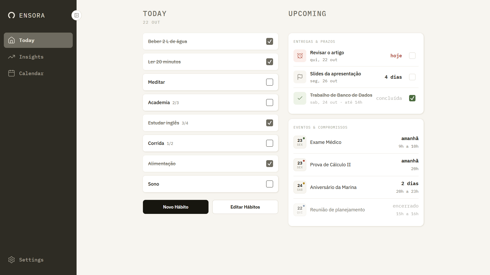
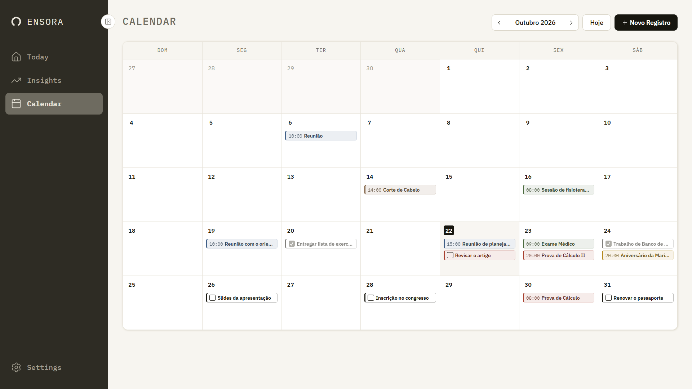
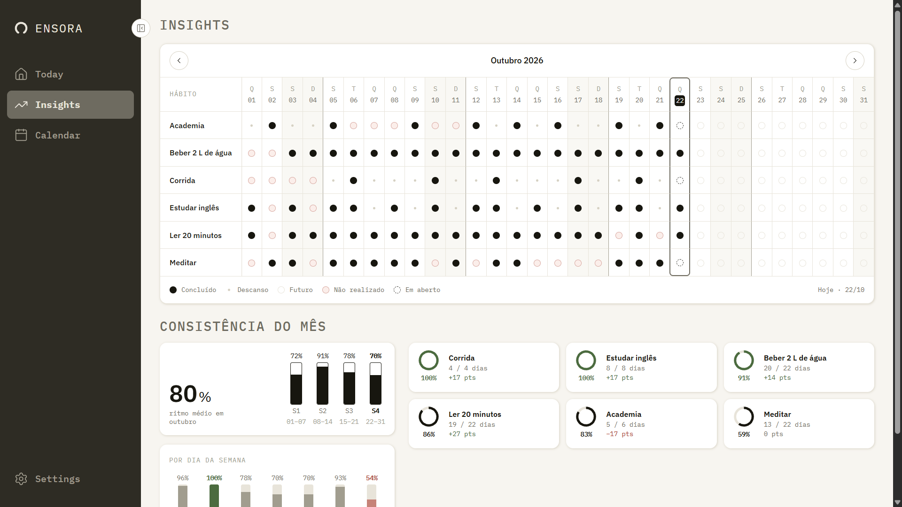
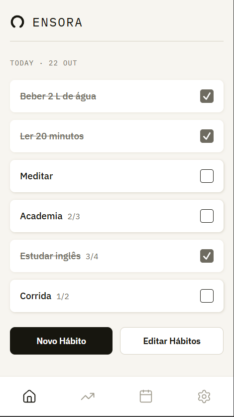
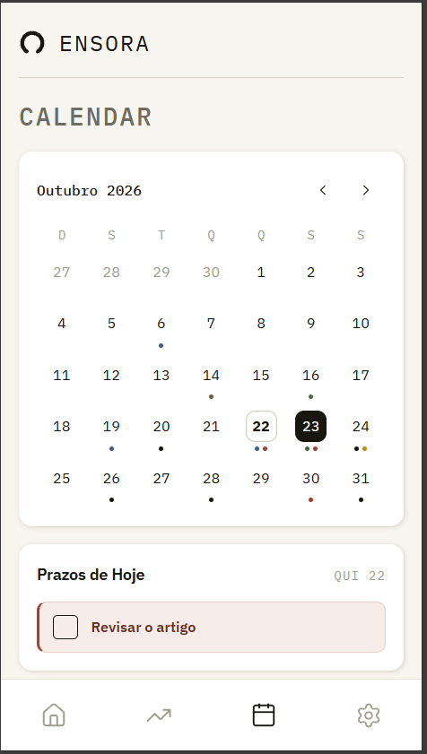
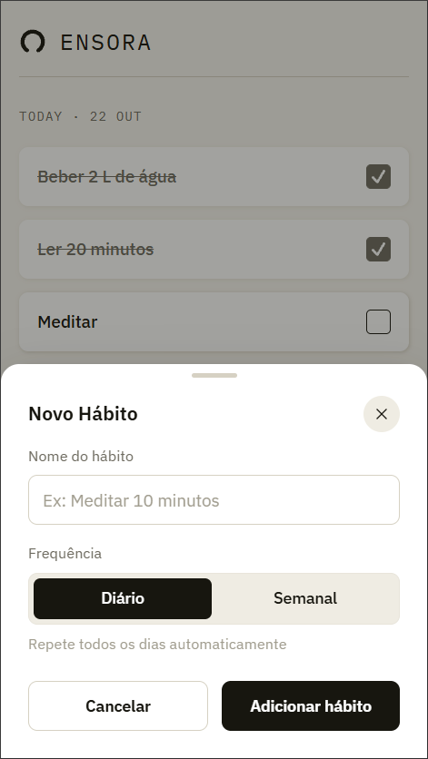

# Ensora

App PWA de rastreamento de hábitos e organização pessoal, com calendário. Nasceu para resolver um problema meu: conseguir **ver o progresso dos meus hábitos** e organizar melhor a rotina, os compromissos, os eventos e as entregas, tudo num só lugar.

**Experimente:** [ensora.onrender.com](https://ensora.onrender.com)

> O primeiro acesso pode demorar um pouco para abrir. Depois disso, a navegação é rápida.
> Dá para **instalar no celular**: no iPhone, abra no Safari, toque em Compartilhar e em "Adicionar à Tela de Início"; no Android, use "Instalar app" no menu do Chrome.

## Telas

| Today | Calendar | Insights |
|---|---|---|
|  |  |  |

| Today | Calendar | Novo hábito |
|---|---|---|
|  |  |  |

## O que ele faz

- **Hábitos diários e semanais.** O semanal tem meta de vezes por semana, e a meta pode mudar sem reescrever o passado.
- **Entregas e eventos.** A entrega tem prazo e mostra de relance quanto falta (e fica em alerta perto do prazo); o evento tem horário, local e categoria. A Home resume o que vem pela frente.
- **Calendar.** Visão do mês com entregas e eventos, em que dá para arrastar um registro para outro dia.
- **Insights.** Consistência de cada hábito no mês e o ritmo ao longo das semanas.
- **PWA instalável.** Abre em janela própria no celular e no computador.
- **Várias contas.** Cada pessoa vê só os próprios dados, com fuso horário próprio. Dá para criar a conta, trocar a senha e excluir tudo.

## Como foi feito

```text
┌──────────────────────────────────────────────┐        ┌──────────────┐
│  Render (um serviço Docker)                  │  JDBC  │  PostgreSQL  │
│  SPA React  +  API Spring Boot em /api       │ ─────► │  (Neon)      │
└──────────────────────────────────────────────┘        └──────────────┘
```

| | |
|---|---|
| **Front** | React 19, TypeScript, Vite, TanStack Query, React Router, CSS Modules, PWA (vite-plugin-pwa) |
| **Back** | Java 21, Spring Boot, Spring Security (JWT), JPA/Hibernate, Flyway |
| **Banco** | PostgreSQL (Neon em produção) |
| **Testes** | JUnit e Mockito, Testcontainers (PostgreSQL real), Vitest |
| **Deploy** | Render com Docker, um serviço só |

### Decisões que valem destacar

- **Sessão com várias sessões por usuário.** O token de acesso (JWT, 15 minutos) fica só em memória no front. O token de renovação é opaco, vai num cookie `HttpOnly`, `Secure` e `SameSite=Strict`, e o banco guarda só o hash SHA-256 dele. Cada dispositivo tem a própria sessão. A cada uso o token é trocado, e se um token já usado reaparecer, todas as sessões da conta são encerradas. Sair encerra só o dispositivo atual, e trocar a senha encerra todos.
- **Isolamento entre usuários provado com banco de verdade.** Testes de integração com Testcontainers criam duas contas e conferem que uma não lê, edita, apaga nem enxerga a outra, inclusive nos Insights e ao excluir a conta.
- **Front e API na mesma origem.** Sem domínio próprio, o backend serve a SPA e a API (sob `/api`) no mesmo serviço, para o cookie de sessão ser de primeira parte.
- **Limite de tentativas por IP real.** Login e cadastro têm limite por IP, lido do `X-Forwarded-For` só quando a conexão vem de um proxy interno, para ninguém forjar o próprio IP.
- **Histórico que não se perde.** Hábitos são excluídos de forma lógica e a meta semanal tem vigência por data, então os Insights de meses passados continuam corretos depois de editar ou apagar um hábito.
- **Fuso por usuário.** O "hoje" de cada pessoa vem do fuso dela, e o front manda a data do relógio do aparelho nas operações do dia.
- **Marcar é instantâneo.** A marcação de hábitos usa atualização otimista, e há uma única renovação de sessão por vez, para abas abertas juntas não derrubarem a sessão.

As decisões, os contratos da API e o modelo de dados estão em [ARCHITECTURE.md](ARCHITECTURE.md).

## Design

O design foi feito por mim no Figma. As telas de referência estão em [`docs/telas`](docs/telas). O app publicado difere delas em alguns pontos, que foram ajustados durante o uso.

## Rodando localmente

Precisa de Java 21, Node 22 ou mais novo, e PostgreSQL (o Docker resolve).

**1. Banco**

```bash
docker run -d --name ensora-db -e POSTGRES_DB=ensora -e POSTGRES_USER=ensora \
  -e POSTGRES_PASSWORD=ensora -p 5432:5432 postgres:17-alpine
```

**2. Backend**, em `backend/`, com estas variáveis de ambiente:

```bash
export DB_URL=jdbc:postgresql://localhost:5432/ensora
export DB_USER=ensora
export DB_PASSWORD=ensora
export JWT_SEGREDO=troque-por-um-texto-com-mais-de-32-bytes
export CORS_ORIGEM=http://localhost:5173
export REGISTRATION_ENABLED=true   # para poder criar a conta
./mvnw spring-boot:run             # no Windows: mvnw.cmd
```

O Flyway cria as tabelas na primeira subida. A API fica em `http://localhost:8080`.

**3. Frontend**, em `frontend/`:

```bash
npm install
npm run dev   # http://localhost:5173
```

Crie a conta pela tela de cadastro.

### Testes

```bash
cd backend && ./mvnw test      # unidade, sem Docker
cd backend && ./mvnw verify    # unidade e integração (exige o Docker aberto)
cd frontend && npm test        # Vitest
cd frontend && npm run lint && npm run build
```

### Imagem de produção

```bash
docker build -t ensora .
```

O `Dockerfile` gera o front, copia o resultado para dentro do jar e entrega a SPA e a API juntas. O `render.yaml` descreve o serviço no Render. Variáveis e detalhes em [`backend/CLAUDE.md`](backend/CLAUDE.md).

## Estrutura

```text
backend/      API Spring Boot (módulos hábito, entrega, evento, calendario, inicio, insights, conta, auth)
frontend/     SPA React (uma pasta por funcionalidade)
docs/telas/   telas de referência do design
Dockerfile    imagem única: front + API
render.yaml   serviço no Render
```

## Licença

Distribuído sob a licença MIT. Veja [LICENSE](LICENSE).

Feito por Gabriel.
